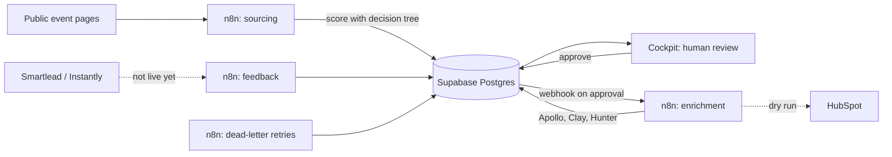

# Event Lead Engine

A lead-sourcing engine and review cockpit for B2B events. It finds speakers and sponsors on public event pages, scores them with a transparent decision tree, and queues them for a person to approve. Nothing is enriched, synced or sent until a reviewer approves the lead.

I built it as a hands-on GTM case study. The example buyer profile is AP and procurement teams that run SAP or Dynamics. The engine is not tied to that profile: a new company means a new buyer profile and event list, not a new engine.

A run on 10 public events across Germany, the UK and the US produced 311 scored leads. The full write-up is in [`docs/`](docs/Event_Lead_Engine_GTM_Case_Write-up.pdf).

**Live cockpit:** [relaxed-pie-e960d5.netlify.app](https://relaxed-pie-e960d5.netlify.app/). Names, companies and contact data stay hidden until the reviewer passcode is entered, so the public view is safe to share. The passcode is shared privately on request.

## How it works

| Layer | What it does |
|---|---|
| `cockpit/` | Single-page app. Tabs for the review queue, events, health and metrics, and how it works. Keyboard review (j/k to move, o to open the source, Shift+A approve, Shift+R reject). |
| `sql/` | The whole backend: tables, views, token-checked functions, access rules. |
| `n8n/` | Six workflows: two for sourcing, enrichment with a HubSpot dry run, Clay email results, outreach feedback, and an error handler that feeds the dead-letter queue. |
| `scripts/` | `find_events.py` (event search and scoring with Serper) and a secret scan to run before every push. |
| `docs/` | The case write-up. |

## Design choices worth reading

- **Fast-and-frugal tree, not a weighted score.** The first failing cue decides the outcome, so a big company name cannot outvote a missing buyer function. Each card shows the path it took, so a reviewer can overrule it.
- **Spend follows the tier.** Tier A gets a company lookup plus a hiring scan (capped at 15 credits per account). Tier B gets one lookup. Tier C and X spend nothing.
- **Human gate before any spend.** Approval is the only thing that triggers enrichment. Approve needs Shift so a stray key cannot start it.
- **Safe retries.** `claim_approved` and `dlq_replay` use `FOR UPDATE SKIP LOCKED`, so two runs never take the same lead. Failures go to a dead-letter queue with exponential backoff and are marked `dead` for a person after 5 attempts. Lead ids are a hash of event, name and company, so a retry never duplicates.
- **Compliance in the data model.** Every lead carries a source tag (`data_lineage`) for the GDPR Article 14 notice. Unsubscribes and spam complaints set `suppressed`. Germany gets no cold email (UWG 7(2)).

## Security model

The public (anon) key is designed to sit in the browser, so the database assumes it is hostile.

- Row level security is on for every table, with no policies. The public key cannot read or write a table.
- It can read only masked views. `leads_review` shows initials and a role level, with company and contact data replaced.
- The full view, `leads_review_full`, is not granted to the public key. It comes back only from `review_queue()`, which checks a reviewer passcode.
- The passcode is stored as a SHA-256 hash. Workflows use a separate token from `app_secrets`.
- Every write goes through a `SECURITY DEFINER` function that checks a token first, and reviewer actions are written to `audit_log`.

## Setup

You need a [Supabase](https://supabase.com) project (free tier works). Use an EU region if your leads are in the EU.

1. **Create the database.** In the Supabase SQL editor, run these in order:
   `sql/01_schema.sql`, `sql/02_views.sql`, `sql/03_functions.sql`, `sql/04_security.sql`.
2. **Set the webhook.** In `sql/03_functions.sql`, replace `YOUR_N8N_WEBHOOK_URL` in `notify_approved()` with the production URL of your n8n Webhook node, then run the file again. Until you do, approving a lead still works and the failed notification is logged to `audit_log` as `notify_failed`.
3. **Add a workflow token and a reviewer.** The commands are at the bottom of `sql/04_security.sql`. Choose your own values and never commit them.
4. **Configure the cockpit.** Copy `cockpit/config.example.js` to `cockpit/config.js` and fill in your project URL and publishable key (Supabase, Project Settings, API).
5. **Open the cockpit.** Open `cockpit/index.html` in a browser, or host the `cockpit/` folder on any static host (Netlify, GitHub Pages). Enter your passcode to unlock names.
6. **Import the workflows** and fill their placeholders. See [`n8n/README.md`](n8n/README.md).
7. **Find events (optional).** `scripts/find_events.py` builds the event list. See [`scripts/README.md`](scripts/README.md).

## What is and is not live

Live: sourcing, scoring, the review cockpit, enrichment on two real leads (one German path, one UK/US path), retries.

Not live: outbound sending, writes to a live CRM (HubSpot payloads are built and checked as a dry run), reply and bounce data, and meetings booked per event. The cockpit's health tab shows these as "not live yet" so the numbers on screen match the claims.

## Before you commit anything

Run `./scripts/check_secrets.sh`. It flags API keys, JWTs, webhook URLs and email addresses. The repo holds no lead data, no `app_secrets` values and no reviewer hashes, and it should stay that way.

## Not legal advice

The compliance choices here are how I designed the system, not legal advice. Check the rules for the markets you sell into before sending anything.
